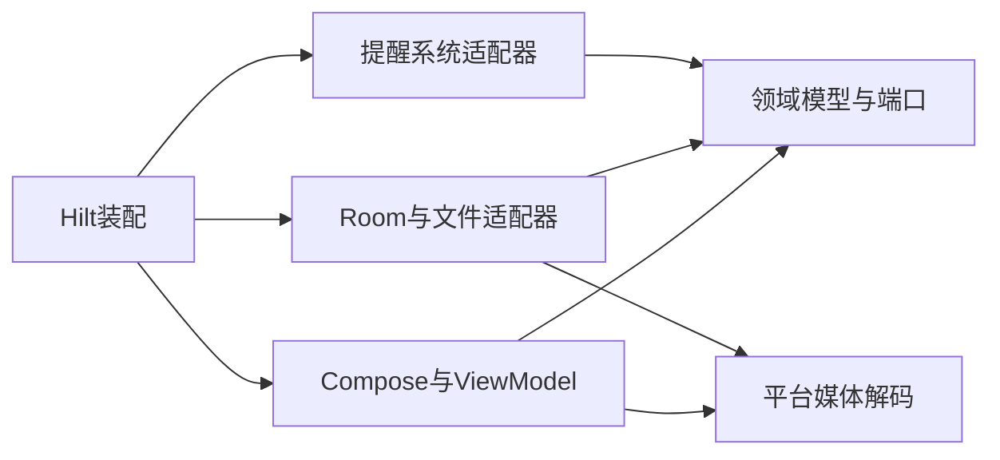

# 当前项目架构

更新：2026-10-23。本文件描述main中1.4.1/code17的架构改进，当前处于正式发布验证阶段；公开版本仍为1.4.0/code16。

## 技术与职责

单Activity Android应用，Kotlin、Compose/Material3、StateFlow、Hilt、Room8、WorkManager；minSdk26、compile/targetSdk35、Java/Kotlin目标17。Gradle9.4.1 Wrapper固定构建工具版本，当前验证运行时为JDK25。应用无AI运行入口及INTERNET权限。

当前只有一个Gradle模块`:app`，以下是包边界，尚未拆成独立编译模块：

| 区域 | 职责与允许依赖 |
| --- | --- |
| domain | 业务模型、规则、仓库/媒体/备份端口、维护准入；仅依赖JVM与协程等库，不依赖Android、data、ui、notification |
| data | Room、迁移、仓库实现、不可变附件存储、内容提供方导入、备份编码与归档 |
| ui | Compose页面、ViewModel、不可变界面状态；通过领域端口读写，不直接访问Room或文件存储实现 |
| platform/media | Android图片采样解码，供媒体导入校验与图片展示共用 |
| notification | 系统闹钟/广播/通知与WorkManager协调，业务规则通过领域端口接入 |
| di | 唯一生产依赖装配；共享数据库、维护协调器、Clock与I/O dispatcher |

`ui/settings`读取只读的`data/about/OfflineLicenses`是当前明确允许的例外，它不提供持久层访问。自动边界检查在`tools/check_project_structure.py`。

## 入口与导航

MainActivity通过Activity ViewModelStore持有真实页面所有者，旋转与标签切换保留编辑会话。V1NavGraph负责Composition与适配器装配。PlanNavigationViewModel通过PlanNavigationEditor/SubscriptionNavigationEditor端口读取不可变快照、请求关闭和打开通知目标；只有NavigationEditorAdapters依赖具体业务ViewModel。

导航继续保留generation、渲染stamp、session与ticket：离开确认后草稿发生变化必须重新确认；通知转交使用通知原世代，不能重新标记为当前世代。计划通知需核对打开后的新session，订阅通知交给订阅所有者消费。端口仍使用业务UI状态类型，尚未达到功能模块完全独立。

## 日记读取与写入

内容观察只发送失效信号，覆盖正式记录、草稿、附件与两种附件关联表。ViewModel在GenerationAccess.read中获取真实当前世代并读取同一Room事务的正式记录和草稿。批量关联查询取代逐篇、逐个附件查询；关联表单独变化也会触发刷新。兼容的observeEntries/observeDrafts仍向既有调用方提供完整数据。

当前列表仍加载完整正文，统计、日历和那年今日保持原语义；没有实现分页、摘要列表或大数据性能承诺。后续分页必须同时设计独立统计/日期索引和按需详情读取，不能只截断entries。

写入使用原世代与修订CAS；草稿1秒空闲/5秒连续输入保存，迟到保存不得覆盖新输入或复活已提交草稿。DiaryMediaAccess/DiaryImportedAttachment属于domain，AndroidDiaryMediaAccess在data实现内容提供方读取和媒体校验；导入pin在引用持久化前保护附件。

## 数据库、维护和媒体锁序

所有模块共享LifeManagerDatabase；当前Room版本8，保留1→8显式非破坏迁移。完整快照必须在同一Room事务中读取全部模块，不通过多个独立数据库分裂这一契约。

锁序：普通全局准入或维护会话 → FileDiaryStorage gate → Room事务。MaintenanceCoordinator只在短gate中管理准入与冻结，不能持gate执行数据库或慢文件I/O；维护先阻止新准入，再等待已准入工作完成。调用方不得重复嵌套全局准入。

备份/恢复/清空后推进数据世代，使旧回调和异步结果失效。媒体不可变，清理依据提交后的持久引用，pin保护并行导出与查看；未知事务结果不能按计划引用删除文件。

## 备份与系统迁移

应用内备份保持V4流式ZIP/Room8契约，含正式记录、草稿、附件、设置与历史兼容数据；V1–V3冻结校验后转换，缺少日记的旧备份恢复时保留当前日记。恢复采用保护备份和独立确认，完整替换，不合并。

未发布分支关闭Android系统云备份，并配置旧版fullBackupContent及新版cloud-backup/device-transfer的持久数据排除规则。手机迁移使用应用内完整归档；规则不能承诺约束所有厂商专有迁移工具，也不删除已存在的系统备份。公开1.4.0安装包的行为不因源码变化而改变。

## 提醒与历史兼容

计划/订阅提醒使用原通知身份、世代和最新持久记录校验；维护后通过统一reconciliation补偿系统状态。系统调度失败与数据库保存成功需要区分反馈。

历史日记回顾类型和表仅为备份往返保留。DiaryAiWorker是无执行退役类，LegacyCloudRetirement仅定向清理旧凭据；不得删除历史数据以代替退役。

## 工程验证

当前入口：`tools/check-project-structure.ps1`或跨平台`tools/check_project_structure.py`；负向fixture验证边界规则能拒绝非法修改。Phase1–4脚本仅供历史阶段查询，不再作为当前版本验收入口。

CI运行边界检查、JVM测试、Lint、Debug与androidTest APK编译。编译测试APK不代表设备测试通过；远程CI结果以真实运行记录为准。Gradle命令串行，设备测试只能使用独立测试模拟器。

本轮验证与限制见[架构改进验收](docs/architecture-foundation-acceptance.md)。历史架构全文见[历史归档](docs/history/architecture-before-2026-10-23.md)。
