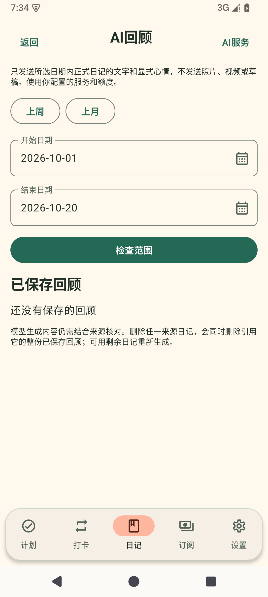
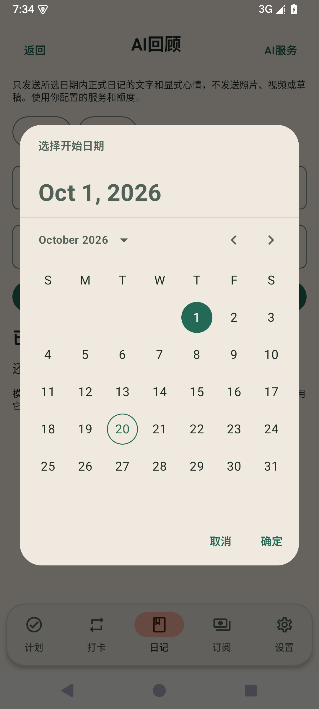

# 1.2.1 页面调整验收

日期：2026-10-20。状态：验证完成，待正式发布。基线为正式1.2.0/code12，目标1.2.1/code13。

## 验收目标

1. 四象限内所有未完成计划直接呈现，超过三项也无需展开；仅已完成计划有展开/收起入口，完成与撤销仍在原象限操作。
2. 日记按记录日期倒序，例如10月20日、10月19日、10月1日。补写旧日记不因创建较晚而置顶；同日按创建时间倒序，时间相同按ID倒序，编辑正文不改变同日顺序。
3. AI回顾开始/结束日期右侧都有日历按钮。字段只读，通过日历选择，确认提交、取消不变；上周/上月预设和检查范围继续使用原ViewModel流程，变更范围清除旧预览与未保存回顾。

## 实现与兼容

PlanScreen移除未完成列表截断与展开状态。DiaryDao两个日记查询与DiaryRules展示排序保持一致。AI回顾使用独立日期输入组件，日期选择器以UTC毫秒表达civil date，避免设备时区使日期偏移，忙碌时禁用。

包名、Room8实体与V4备份不变，无新增迁移或破坏性操作；升级保留原日记、草稿、媒体、计划、打卡、订阅、设置和AI回顾。沿用正式签名轮换链，不更换安装身份。

## 本轮验证

定向Gradle回归19项全部通过，涵盖超过三项未完成计划、已完成折叠、跨日期与同日稳定排序、修改旧记录日期、真实Room查询、日期选择确认/取消、非UTC日期和禁用后重新启用。签名工具17项通过。本轮1295项JVM/125套件、79项API35设备测试、17项签名工具测试全部通过，failure/error/skipped均为0；Debug/androidTest/Release构建成功，lint0错误/51警告。正式签名六个SDK检查点及16KiB对齐通过。现有API35正式1.2.0覆盖升级到1.2.1后，23张表全部字段、类型、NULL值及序列逐值一致，应用UID和签名身份保持。[本轮验证汇总](evidence/page-polish-1.2.1-validation.json)。

先在旧实现上运行18项，四个新增预期失败分别复现查询排序、展示排序、缺少日期按钮及计划截断。实现后19项中首次有三项界面定位失败：长列表目标未滚到可见位置，日历日期用完整本地化日期替代数字语义。修正测试滚动后剩两个日期定位失败；按Material3实际格式化日期定位后第三轮19项全通过。生产实现未因测试定位问题额外修改。原始日志为.tools/polish-1.2.1-{red,green,green-round2,green-round3}.log。

## 发布

测试、签名、实际覆盖升级及443份应用源码文件核对均已完成，等待推送并发布正式GitHub Release。APK内嵌构建提交为`9466278a17d24e496410fce4dbbb82d36dffef03`，发布标签将包含后续验收文档，应用源码保持一致。

APK：12,787,952字节，SHA-256 `78a5e5c5a51915162efb83eecead44f132cfc254fb84d08962e46bb2b1335723`。

## 验证限制与过程

本轮覆盖升级仅验证一台已有数据的API35模拟器，空表仅证明空表保留；未新增API26/28覆盖升级或真机验收，数据库比对不覆盖私有文件和偏好设置。

覆盖升级准备阶段首次因Android15使用appId字段而非userId字段停止，尚未安装候选包，未创建升级快照目录；修正验收脚本并验证UID解析后重新准备，实际覆盖安装及升级后核对通过。原失败日志保留为.tools/polish-1.2.1-upgrade-prepare.log。

## 正式候选包截图

以下为API35模拟器覆盖升级后实际界面，日期选择器月份语言跟随设备英语区域设置；确认、取消及应用字段为中文。未给升级设备添加业务测试数据。

