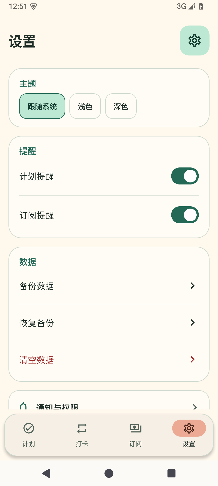
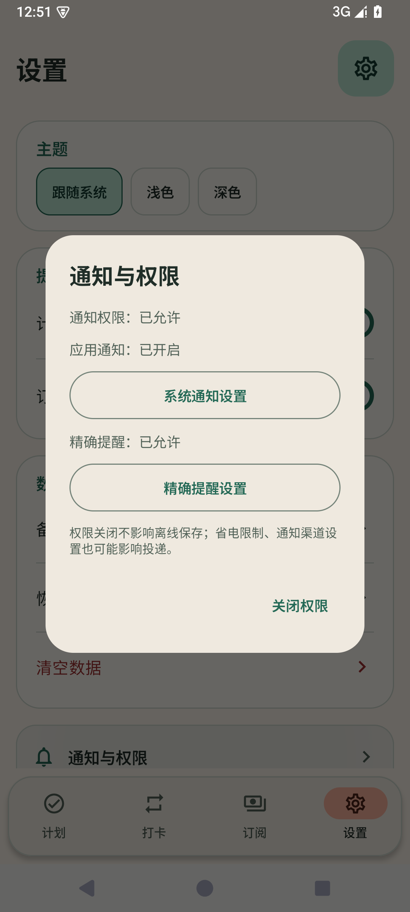
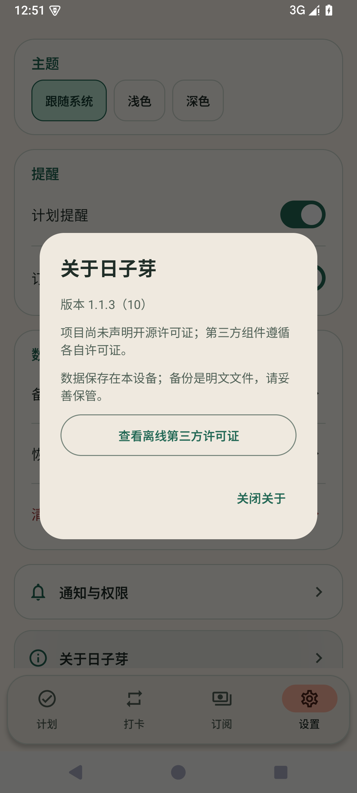

# 设置页精简验收

2026-10-19；基线main `f71121e`，1.1.3/code10/Room7。用户要求设置页与计划、打卡及订阅风格一致，信息简洁，取消日期格式调整并默认YYYY-MM-DD；沿用会话中直接推送main、发布APK及Release的交付要求。已于2026-10-19T00:54:02+08:00公开发布预览版；[机器汇总](evidence/settings-polish-1.1.3-validation.json)。

## 实现范围

主页保留主题紧凑选项、计划/订阅提醒开关、备份/恢复/清空数据操作及权限/关于两个入口。奶油背景、薄荷绿选中态、描边圆角卡片沿用现有MaterialTheme，深色跟随主题，大字体可滚动并换行。移除首页已完成模块、长说明、日期选项、人民币及提前提醒的重复介绍。

通知与权限、关于日子芽在点击后显示可滚动弹窗；原权限真实读取、ON_RESUME重读、系统Intent包名与异常恢复保持。忙碌时首页入口及已开弹窗的系统动作禁用，关闭仍可用。关于内提供版本与完整离线许可证，Apache原文可读到底并返回依赖清单，关闭许可证返回关于。

全局标准日期固定YYYY-MM-DD；日期时间显示HH:mm并继续按指定时区转换Instant。原存储MDY/DMY偏好、枚举、VM兼容接口及历史备份值保留，不重写业务日期/时间或数据库。Room7和format3/schema7保持，无迁移。备份只精简入口文案/容器，原OpenDocument/CreateDocument票据、明文授权、严格预览、保护备份、独立最终确认、UNKNOWN核对与维护世代保护保留。

## 验证过程

先仅更新测试，`.tools/settings-polish-red.log`：22项，16失败、0error/0skipped，全部为要求中的新行为断言（固定日期2、平台入口/弹窗11、设置去除旧控件3），不是编译错误或未修改旧版基线。原始XML保留`.tools/settings-polish-red-results`。随后实现，增加忙碌状态与旧回调保护测试；完整JVM/Debug/androidTest/Release/lint及最终数量见下文。

根设置/备份入口经独立只读复审9/10，无新增阻断问题。主题FlowRow不固定单行，备份操作和票据/确认保护保持。历史返回计划在保存时视觉可用但导航层阻止的行为未扩大修改。此复审不替代运行结果。

首次完整构建`.tools/settings-polish-full-first.log`执行1210项/107套件，3失败、0error/0skipped；失败均为导航/真实Activity测试仍查找已删除的“导出完整V3备份”文案，发生于点击前，原保护断言未执行。更新这两个测试文件为“备份数据”，先以未合并文本滚动、再定位可见且启用的合并操作；隐私授权、待处理通知互斥和捕获旧回调的断言保留。Debug/androidTest/Release及lint均完成，首轮lint为0Fatal/0Error/29Warning，整轮因上述3项测试失败而失败，未计作通过。随后完整重跑所有1210项及构建/lint，最终结果见下文，没有用3项定向结果替代。

初始与修正后的384文件快照比较，仅上述两个JVM测试文件改变，生产、构建、Android测试及schema源未改变。最终快照SHA-256 `1376452bed6b310b986fc1b385763c333bdbe80bc92d8aed38a8b05c954cd841`，提交前后核对规范化换行后的每个文件。提交核对使用一次Git cat-file批量读取blob，并先用上轮已逐个git show核对过的384文件/源码`0bc4d06`验证批量解析结果一致。

专用`Rizhiya_Settings_Polish`/`emulator-5564`已安装已发布1.1.2，并在新空库保护检查通过后植入8订阅、5付款、9旧提醒、2计划、2习惯、3树、4记录和2浇水关联，另将合成设置的dateFormat设为历史DMY。准备快照为`.tools/settings-upgrade-20261019`；随后执行覆盖升级及逐表核对，结果见下文。构建重跑时关闭本轮模拟器释放内存，保留其数据；未操作个人设备。

## 验证边界

本轮将使用专用API35模拟器与合成数据，真实手机、厂商后台限制、手动TalkBack、大数据量、全部云文件提供方和正式商店签名不扩大为验收通过。历史发布及其验收数字保持，不能替代本轮实测。

## 最终验证与安装包

本轮1210项JVM/107套件、74项API35设备测试/27套件全部通过，failure/error/skipped均0；Debug/androidTest/Release及lint成功（0错误/29警告）。真实1.1.2覆盖升级核对16张表所有字段和自增序列一致，历史DMY设置原样保留。完整重跑日志`.tools/settings-polish-full.log`，原始JVM XML另存`.tools/settings-polish-jvm-final`。设备完整包日志`.tools/settings-polish-device-final.log`，74个开始/成功状态包相符；深色200%字体、真实系统文件选择器取消、主题重建、旧日期偏好忽略但不改写、完整离线许可证读到底等断言均包含。

已签名`rizhiya-1.1.3-settings-polish-preview.apk`，12,517,815字节，SHA-256 `5c0a987e8138d87a1ed630cf0f1973c57d607aa25e20a4944d62f1dfd3683b00`。包名com.example.lifemanager，1.1.3/code10，非debuggable，v2/v3及16KiB对齐核对通过。原预览证书SHA-256 `55384b8e26f776f9389df25721a3cd955752a03bc7cdf8e94c0f249829dfa16c`与1.1.2一致；设备用install -r从原发布APK覆盖到此签名候选，未卸载/清库。

升级后16张表结构、全部字段值、自增序列及外键核对一致；设置/世代、DMY偏好、旧提醒、外币和空白备注等原值保留，证据`.tools/settings-upgrade-20261019/verified.json`。为完整设备包准备空业务库前再次核对全快照，只删除脚本记录的合成父ID，验证级联及默认表/序列保持，记录`cleanup/cleaned.json`。未操作个人设备或删除其他数据。

以下为本轮真实1080×2400设备截图，原图未修饰；首页隐藏权限详细状态、日期选项和长功能说明。

| 设置主页 | 通知与权限 | 关于日子芽 |
| --- | --- | --- |
|  |  |  |

## 发布核对

用户要求直接推送main。全部384个应用/构建/schema/测试文件与实际已测快照、提交`86e228c3d7b0feb50e9a6afd31712cb13904ac32`逐文件核对一致后提交并推送；发布前GitHub main与标签`v1.1.3-rizhiya-preview-20261019`均核对为该源码。后续只补发布文档，应用源不再改变、APK不重签。

[1.1.3预览Release](https://github.com/LieerTsuki/Daybud/releases/tag/v1.1.3-rizhiya-preview-20261019)于2026-10-19T00:54:02+08:00公开；[APK](https://github.com/LieerTsuki/Daybud/releases/download/v1.1.3-rizhiya-preview-20261019/rizhiya-1.1.3-settings-polish-preview.apk)匿名回下载12,517,815字节，SHA-256 `5c0a987e8138d87a1ed630cf0f1973c57d607aa25e20a4944d62f1dfd3683b00`与已签名、已覆盖升级验收的候选相同；SHA256SUMS.txt也回下载逐字节一致。发布状态与资产元数据来自GitHub认证发布响应，回下载不带凭据。历史Release与APK保留。[实际发布回执](evidence/settings-polish-1.1.3-publication.json)。
