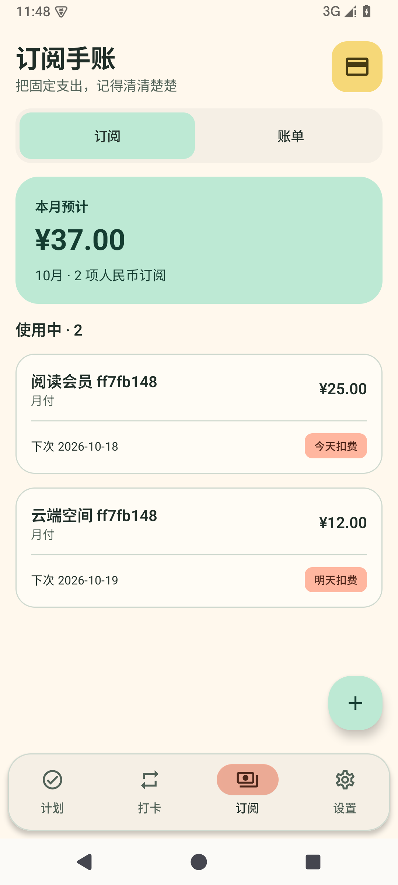
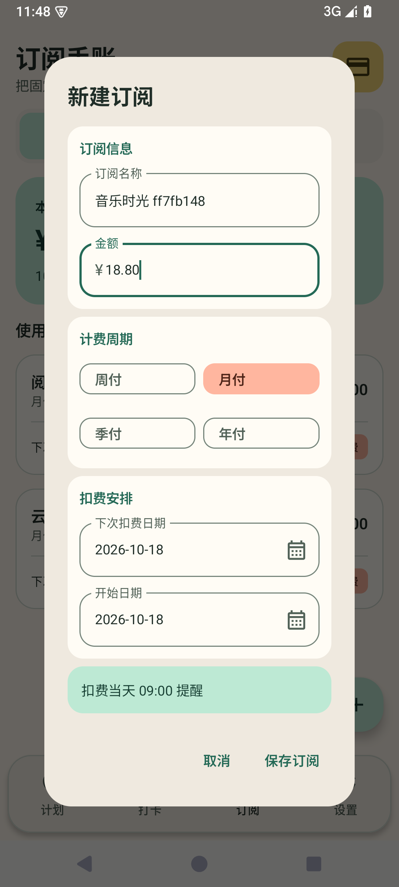
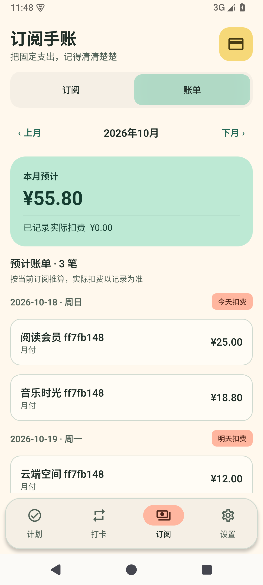

# 订阅账单改版验收

2026-10-18；基线`5b69285`，分支`feat/subscription-bills`；候选1.1.2/code9/Room7。用户确认采用月度账单并授权直接推送GitHub main和发布APK。开发与验收已完成，尚未发布；[机器汇总](evidence/subscription-bills-1.1.2-validation.json)。

## 实现范围

列表沿用日子芽奶油背景、薄荷绿费用概览和描边圆角卡片，显示使用中订阅与临近扣费状态，取消项目可展开查看。移除CSV入口及多币种说明。新建固定人民币；旧外币订阅保留原始金额与币种标识，不换算、不混合累计。

订阅编辑按信息、周期、扣费安排分组，金额使用十进制键盘、日期支持选择器；移除分类、备注、币种选择和提前提醒选项。历史隐藏字段须原样保留。实际扣费仍需手动记录，其金额前缀显示不可修改的人民币符号或历史币种。

账单替换统计页；可切换月份，显示当月预计总费用和日期分组明细。今天与临近扣费突出显示；实际记录及其总额单独展示，不把已过的预计日期当成已支付。预计按当前有效订阅和原始锚点推算，取消后不再预测，实际历史仍保留；月末、闰年和周付沿用原锚点规则。历史外币不进入人民币合计。没有趋势、分类或周期分布图。

所有有效订阅统一按设备当地扣费日09:00调度，包括旧空提醒偏好；旧1/3/7天闹钟和通知退役，旧广播不得发送提前提醒。保留全局提醒开关、通知/精确闹钟权限、维护世代、迟到当日交付、消费与重试保护。新鲜调度在当天09:00之后寻找下一周期，不补发历史通知；已在等待的合法当日闹钟仍可迟到交付。非精确闹钟及厂商后台限制可能延迟通知。

Room7、安装身份和format3/schema7完整备份保持；历史提前量仍原样保存和备份，不向存储中写0，因此旧V1/V2严格验证与新V3往返契约不变。历史预览签名将用于覆盖安装验证。

## 本轮过程记录

- 订阅RED：153项，34失败、0error/0skipped，`.tools/subscription-baseline.log`。失败覆盖当天提醒不支持、旧提前广播策略、币种默认、旧字段覆盖以及旧CSV/表单/统计界面；该日志虽名为baseline，已包含本轮新增及调整测试，不能称未修改测试的旧版基线。
- 设置首轮排队验证在界面文件拆分期间遇到`SubscriptionWorkspace`尚未创建的编译错误，`.tools/subscription-settings-red.log`；未计为行为测试结果，完整文件到位后独立重试。
- 专用模拟器`Rizhiya_Subscription_Bills`/`emulator-5562`安装1.1.1，并在新空库保护下植入8订阅、5付款、9旧提醒选择及其他模块合成记录。初次采证在ADB非root时被保护检查拒绝，未写数据；重启专用模拟器ADB为root后完成准备。升级核对结果见下文。
- 独立审查发现仓库会裁剪隐藏的旧分类/备注空白，已修复并以真实Room回归核对；另补实际金额固定币种前缀，修正设备测试合并语义树卡片选择器。

## 全量构建与JVM验证

`.tools/subscription-first-full.log`：本轮1206项/107套件全部通过，failure/error/skipped均0；Debug、androidTest、Release构建及lint成功，0Fatal/0Error/29Warning。155项构建任务中59执行、96缓存核对，总耗时15分34秒；JVM实际执行，非复用历史数字。原始XML另存`.tools/subscription-jvm-final`，机器汇总`.tools/subscription-jvm-results.json`。离线lint保留既有依赖检查口径，不将历史在线警告差异当修复。

命令为Gradle9.4.1 `--daemon --max-workers=2 --console=plain --offline --continue '-Pkotlin.incremental=true' :app:testDebugUnitTest :app:assembleDebug :app:assembleDebugAndroidTest :app:assembleRelease :app:lintDebug`，JDK25、字节码17；增量开关仅用于本轮本地命令，仓库构建配置保持。初次命令未给PowerShell中的点号参数加引号，被拆为`.incremental=true`任务而在执行前失败，另存`.tools/subscription-full-argument-error.log`；修正后为上述成功轮次。

真实Room回归先4/4预期失败，再纳入全量通过，覆盖隐藏字段空白/换行、null/空字符串、事务内最新记录及取消/恢复。初次仓库回归遇到Windows资源不足和KAPT输出哈希读取失败，未算作行为RED；关闭本轮专用模拟器并限制构建并行后，`.tools/subscription-repository-red-retry.log`完成4项预期断言失败。独立只读复审9/10，已关闭原有发现；复审不替代运行结果。

## 签名候选

`.tools/delivery-subscription-bills/rizhiya-1.1.2-subscription-bills-preview.apk`，12,517,815字节，SHA-256 `7423e40c3a54cbb1aa3ea5a4614f08b9008ac62ec52ee7d5f538d00ef97a4981`。包名com.example.lifemanager、1.1.2/code9、非debuggable、v2/v3与16KiB对齐均核对。原证书SHA-256 `55384b8e26f776f9389df25721a3cd955752a03bc7cdf8e94c0f249829dfa16c`，与1.1.1一致。

签名后采证脚本最初期待对齐输出`Verification successful`，build-tools35实际拼写为`Verification succesful`；原生命令退出码始终为0。复核原始输出并只继续验证元数据，没有重签名或覆盖该候选。记录为`.tools/subscription-apk-{signature,badging,alignment}.txt`和`.tools/subscription-apk.json`。构建384个应用/构建/schema/测试源文件已记录规范化换行后的摘要，发布前须与提交再次核对。

## 实际APK覆盖升级与09:00通知

在同一专用AVD上以`install -r`将已发布1.1.1/code8覆盖为上述原证书1.1.2/code9，两次安装之间不卸载、不清数据。升级启动后，16张表所有结构、字段值与自增序列完全一致；8订阅、5付款、9旧提前配置、2计划、2打卡任务、3树、4记录和2浇水关联保留，设置/世代不变，外键检查0异常。含USD/EUR历史金额、分类/备注的原始空白/换行、取消订阅、计划关联和旧1/3/7偏好。证据`.tools/subscription-upgrade-20261018/verified.json`。

同一非debuggable签名APK，真实Android AlarmManager验证7个有效订阅的调度身份全部为0、触发时间均当地09:00:00；将专用AVD时钟设为上海08:59:35，9点前无当天通知，在09:00:00观察到真实“今天扣费”系统通知。完成后恢复实际时钟。该场景独立于JUnit数量，不计作额外仪器测试。原始闹钟/偏好/通知转储与恢复回执在`.tools/subscription-nine-native-shanghai`。

首次通知采证误将模拟器的GMT时区按上海转换，保护断言在等待通知前拒绝通过，时钟仍由finally恢复；未算作功能失败或通过。通过系统alarm服务将专用模拟器固定为Asia/Shanghai、使用服务设时后，在全新证据目录完成上述真实投递验证。真实设备/厂商后台不扩大为通过。

为完整设备测试准备空业务库时，先再次核对原始16表和序列完全匹配，仅删除脚本记录的合成父ID并验证级联；默认表和自增序列保留，独立设备快照与预期一致。未卸载或清空应用数据，未操作个人设备。该步骤记录`.tools/subscription-upgrade-20261018/cleanup/cleaned.json`，不将删除SQL冒充已清理操作缓存；后续生产启动负责取消失效闹钟。

## 设备回归过程

首轮完整设备测试74项，2失败，均为已有备份文件选择器测试在点击前找不到屏外按钮的合并语义文本；新增订阅实际数据库场景通过。保留首轮`.tools/subscription-device-full.log`，没有将失败计为通过。修正仅限测试：等待设置页面及可操作状态，以未合并文本滚动，再断言合并按钮可见、启用并点击；仍必须观察真实DocumentsUI及系统返回取消、`UNCHANGED`结果。

首轮列表截图捕获到导航前的计划页，未作为订阅验收图；订阅设备测试补充目标页面标题和账单月份按钮断言，截图前等待主线程及原生界面空闲。另两张正确截图也在最终完整设备轮次重新采集。最后两处测试修改经独立只读复审通过，保留真实Room记录、新建金额1880分/CNY/无分类备注、日期选择器、切月及打开正确详情的断言。针对这两个测试类的3项定向回归全部通过，`.tools/subscription-device-focused.log`，不与完整测试数量相加。

最终`.tools/subscription-device-final.log`：完整74项全部通过，仪器状态包74个开始和74个成功，failure/error/skipped均0，耗时86.603秒。首轮两项备份失败已通过，计划、打卡森林、备份、维护导航及订阅场景均包含在完整包内。以下为该轮真实1080×2400截图，原图无修饰；名称后缀是隔离测试数据的UUID。

最后两处测试调整后，重新构建androidTest并完成lint，`.tools/subscription-device-test-fix-build.log`成功（70任务，10执行/60缓存核对；10分2秒），0Fatal/0Error/29Warning。与全量JVM/Release构建时的384文件摘要比较，仅上述两个Android测试文件变化；生产、JVM测试、构建与schema源内容完全一致，已签名APK字节不变。最终384文件摘要SHA-256 `d1f061fe63b45135d6e28ba31be52594c24ac06703b5eff9ae489f50a4b1ec17`，提交前和提交后逐文件核对。该测试修改无须重新签名或重复运行未变化的1206项JVM。

| 订阅列表 | 新建订阅 | 月度账单 |
| --- | --- | --- |
|  |  |  |

## 验证边界

设备与升级验证均在API35专用模拟器、合成数据上完成。真实手机、厂商后台限制、手动TalkBack、大数据量、全部云文件提供方及正式商店签名未验收。通知需开启模块总开关并授予系统通知权限；缺少精确闹钟权限或受到后台限制时可能延迟。
